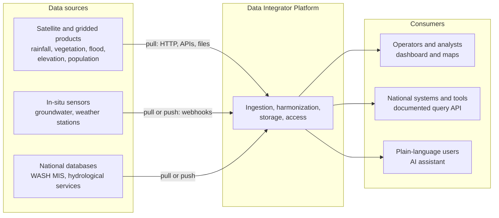
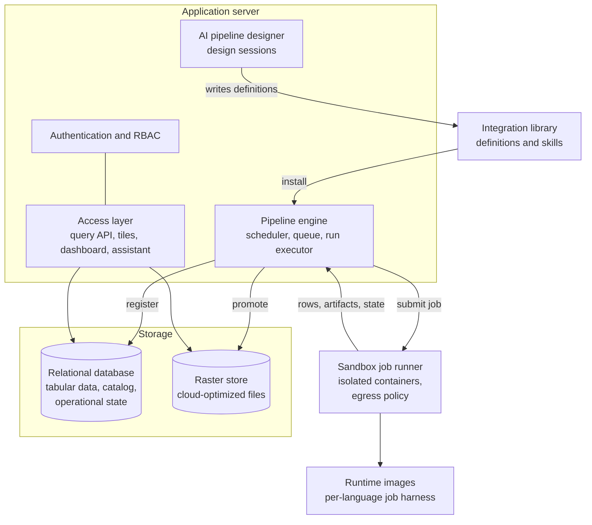
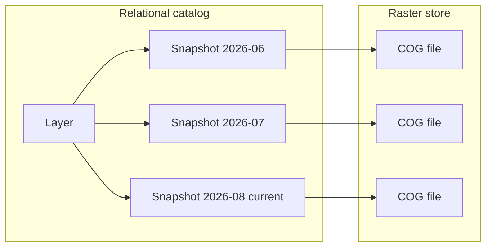
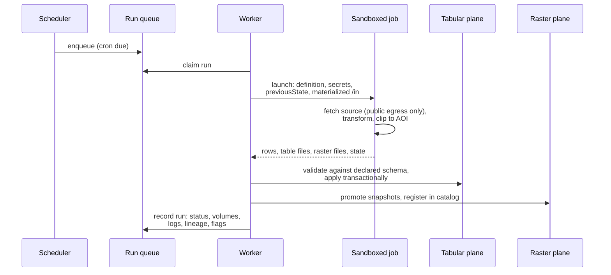
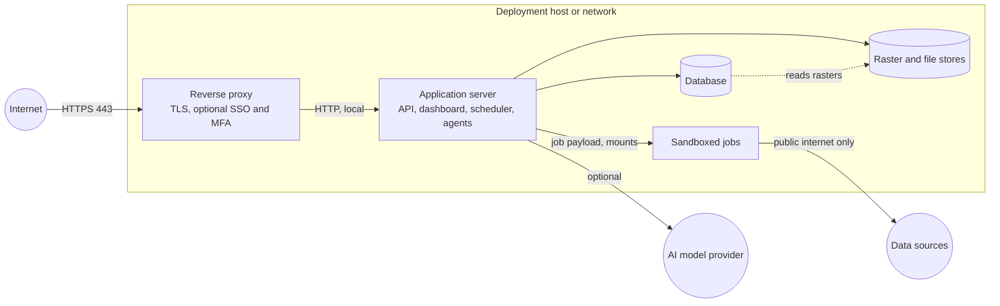

# Data Integrator System Architecture

This document defines the architecture of the Open Source Data Integrator
Platform: a self-hosted system that ingests multi-source water and climate
data, harmonizes it into standardized and interoperable formats, and exposes
it through a documented query interface, a dashboard, and an optional AI
assistant. An agentic AI capability designs, tests, and maintains the
ingestion pipelines themselves.

The architecture is modular, standards-based, and technology-agnostic. It
specifies components by their responsibilities and contracts so that any
vendor can implement it with their own technology choices. Section 7 maps
the architecture onto the reference implementation (mWater Data Integrator,
published under the same open-source license); nothing elsewhere in the
document depends on those choices, and no part of the architecture requires
that implementation.

Companion documents:

- *Interoperability and Standards Mapping*: the standards each interface
  conforms to and the integration paths for national systems.
- *Integration Library Specification*: the machine-readable definition format
  for data sources, independently reusable.

## 1. Design principles

1. **Self-hosted and open source.** The platform deploys from a public
   repository onto infrastructure the operator controls. No vendor account,
   license, or hosted service is required to run any core function.
2. **Configuration-driven.** Connecting a new data source is a new
   integration definition, not a change to the platform. Definitions are
   machine-readable data, portable across implementations.
3. **The job contract is the architecture.** Ingestion code runs in sandboxed
   jobs against a small, language-agnostic contract. Programming languages
   are interchangeable runtime images that implement the same contract.
4. **Two data planes.** Tabular data lives in a relational database with
   spatial types. Raster data lives as cloud-optimized files in a store with
   a relational catalog. Each plane uses the storage suited to it.
5. **Bounded work.** Every heavy operation is clipped to a configured area of
   interest. A deployment for one country downloads and processes that
   country's window of global datasets, which is what makes low-cost,
   low-connectivity deployments viable.
6. **AI is optional and replaceable.** Ingestion, storage, scheduling, and
   the query interface are fully functional with no AI model configured. The
   model behind the agentic capabilities is a configurable dependency with a
   documented minimum capability profile, satisfiable by self-hostable
   open-weights models.
7. **Provenance everywhere.** Every stored datum traces to the run that
   produced it, the definition version that ran, the inputs it consumed, and
   the area of interest it covered.

## 2. System context



The platform sits between heterogeneous data sources and three kinds of
consumers. Sources are reached two ways: pipelines pull from APIs, file
servers, and satellite product archives on a schedule, and push-capable
sources (typically sensor networks) deliver events to per-integration webhook
endpoints. Consumers read one harmonized store through role-gated interfaces.

A deployment serves one institution (a ministry, a country office). Multiple
countries are multiple deployments of the same software, each configured with
its own area of interest, sources, and users.

## 3. Component architecture



| Component | Responsibility |
|---|---|
| Integration library | Machine-readable definitions of data sources and the know-how to ingest them |
| Pipeline engine | Triggers, queues, executes, and records ingestion runs |
| Sandbox job runner | Executes integration code in isolated containers under resource limits and an egress policy |
| Runtime images | Map the language-agnostic job contract onto each supported language |
| Harmonization | Declared target formats (units, projections, time, codings), schema enforcement on load, data-quality validation |
| Tabular plane | Relational destination tables with spatial types |
| Raster plane | Immutable cloud-optimized raster snapshots with a relational catalog |
| Access layer | Documented query API, raster catalog (STAC), map tiles, dashboard, analytical dashboards, AI assistant |
| AI pipeline designer | Agentic design, testing, and maintenance of integrations |
| Security components | Accounts, roles, secrets, sandbox isolation, read-only analytical SQL |

### 3.1 Integration definitions and library

An integration is described entirely by one machine-readable definition:

```
{ id, name, description, source, trigger, secrets, aoi, inputs, files,
  runtime, limits, destinations, validation, code, contract }
```

- `source` documents the upstream provider, license, and documentation URLs.
- `trigger` declares when the integration runs: a cron schedule, webhook
  events, or both. Webhook triggers may declare a batch window so
  high-frequency feeds are processed in batches rather than per event.
- `secrets` names the credentials the code needs. Values are never part of
  the definition: the deployment stores them with the integration (write-only,
  encrypted), so an exported definition never carries them and the
  importing deployment sets its own.
- `aoi` is the area of interest. It is tri-state: an explicit bounding box
  clips ingestion to it, an explicit null means the source's full extent, and
  omission inherits the deployment's default AOI at run time. The box is a
  download window. An area that names countries is also resolved to a
  boundary shape (the countries' land outlines from a bundled public-domain
  boundary dataset, inland water removed, cut to the box), and that shape is
  what statistics "of the country" and map drawing clip to.
- `inputs` references catalog layers and tables that this integration
  consumes, which is how derived analytics (drought indices, exposure
  statistics) are expressed as ordinary integrations.
- `files` declares file slots: user-uploaded files (spreadsheets, shapefiles)
  the code reads. The definition names the slot; the deployment holds the
  versioned contents, and uploading a new version can re-run the
  integration against it.
- `destinations` declare the outputs: tabular schemas (columns, types,
  merge behavior) and raster layers (bands, units, nodata, rendering).
- `validation` declares quality rules: value ranges for numeric columns and
  raster bands, and an expected cadence for freshness monitoring.
- `code` is one self-contained file in the declared `runtime` language.
  Work that outgrows one file is split into chained integrations connected
  through `inputs`, keeping every unit independently testable.

The library is a versioned directory of these definitions plus *skills*:
prose documents capturing per-source and per-technique know-how that the AI
designer loads on demand. The library is deliberately independent of the
platform: it is a common reference any implementation can consume.

Installing a library entry copies the definition into the deployment, where
it becomes the integration's single specification. Every subsequent change,
whether made by an operator or the AI designer, archives a new attributed
version. Updating from the library preserves the deployment-owned fields
(AOI, trigger, limits). This gives full change history without a separate
override layer.

### 3.2 Pipeline engine

The pipeline engine turns definitions into recorded runs.

- **Triggers.** A scheduler evaluates cron triggers once per minute (UTC). A
  public webhook receiver accepts pushed events on per-integration
  capability URLs, buffers the payloads, and enqueues a run, immediately or
  at the end of the declared batch window. Operators can run any integration
  manually. The AI designer's test runs execute directly in the session,
  outside the queue, against session-scoped scratch destinations.
- **Queue.** Runs queue in the database. Any number of workers drain the
  queue; database constraints guarantee at most one queued and one running
  run per integration, so runs are serialized per integration and burst
  triggers coalesce instead of stacking.
- **Incremental state.** Each successful run may return a state object that
  the next run receives. This is the only authoritative incremental state,
  and it is what makes ingestion resumable: after connectivity loss or
  downtime, the next run continues from the recorded state and backfills the
  gap.
- **Inputs.** Before launching a job, the engine resolves the definition's
  `inputs` to concrete snapshot and table versions and materializes them
  read-only inside the job. The resolved versions are recorded on the run,
  which is the lineage record for derived data. Whether new inputs warrant
  new output is the integration code's decision.
- **Records.** Every run stores its trigger, status, timing, data volumes,
  logs, error, definition version, resolved inputs and file versions, the
  AOI it executed with, and any data-quality findings (3.4).
- **Liveness.** Running jobs heart-beat; a reaper fails runs whose worker
  died, so the queue never wedges.

### 3.3 Sandbox executor and the job contract

All integration code executes in sandboxed, resource-limited containers. The
platform never runs source-specific code in its own process.

The job contract is language-agnostic:

- **stdin**: `{ definition, secrets, previousState, webhookData?, params,
  catalog }`. `webhookData` is every pending webhook event, oldest first;
  `catalog` lists the snapshots already published to each raster
  destination, so the code can skip periods it has already produced.
- **stdout**: `{ data?, tables?, rasters?, state? }`. Small tabular results
  return inline in `data`; larger tables are written as files and referenced
  in `tables[]`; raster outputs are files referenced in `rasters[]`.
- **stderr**: logs, captured and stored with the run.
- **`/in`** (read-only): materialized inputs and uploaded files, with a
  manifest describing them.
- **`/work`**: a persistent per-integration workspace with cache semantics.
  It may be wiped at any time; correctness never depends on it. A disk quota
  is part of the job limits.
- **`/out`**: where the job writes its file artifacts.
- **`/tmp`**: per-run temporary space on disk, empty at the start and
  discarded with the job, with its own disk quota; the rest of the filesystem
  is read-only.
- Nonzero exit fails the run; the stderr tail becomes the error message.

A per-language harness in each runtime image maps this contract onto a single
entrypoint function, so integration code is a plain module with no
platform-specific imports. Two runtime images are specified, one for
JavaScript and one for Python, the latter carrying an open geospatial stack
(raster, array, and vector libraries) that the library's integrations rely
on; further languages are additional images implementing the same harness
contract. Each harness is verified against that contract by its own tests;
the reference implementation keeps one suite per runtime image.

Jobs never touch the database or the raster store. The engine validates
tabular output against the declared destination schema and applies it
transactionally (a file-based table load has the same atomicity as inline
rows), and registers raster artifacts in the catalog. This is the boundary
that makes sandboxing meaningful: code inside the sandbox produces data,
and the platform outside the sandbox decides what to do with it.

Sandbox properties (see also section 5):

- Rootless containers with a second isolation layer intercepting syscalls.
- Read-only root filesystem, no capabilities, per-job CPU, memory, disk, and
  wall-clock limits, declared in the definition and lowered to
  deployment-wide maximums.
- Egress to the public internet only: private, link-local, and cloud
  metadata address ranges are blocked at the network layer inside the job's
  network namespace.
- Curated libraries are baked into the runtime images and pinned; jobs
  cannot install packages at run time.

### 3.4 Harmonization

Harmonization is split between declaration and enforcement. Definitions
declare the target formats. For tables the platform enforces them when it
applies a result: values are cast to the declared column types and
geometries stored in WGS 84. For rasters, registration reads only the
footprint, CRS, and cell size from the files; the COG layout, band count and
order, nodata value, and units are declared, and producing files that match
is the job's responsibility.

- **Units.** Bands and columns declare their units; values are stored in the
  declared units.
- **Projections.** Tabular geometries are stored in a single geographic CRS
  (WGS 84). Rasters keep their native grid and CRS to avoid resampling loss
  at ingest; the catalog records the CRS per snapshot, and map tiles are
  warped to the web projection at render time.
- **Boundaries.** Pixels of a clipped raster extend past the coastline and
  the border, so the deployment's area of interest is materialized as a
  land-only shape with recorded provenance (dataset and version). Area
  statistics weight coarse pixels by the part inside the shape, fine pixels
  by their area at their latitude, and report the share of the shape covered
  by valid data; map tiles are cut to it.
- **Time.** All timestamps are UTC. Raster snapshots carry an instant or an
  explicit time range.
- **Missing data.** Bands declare their nodata convention, and analytical
  interfaces respect it, so sentinels never contaminate statistics.
- **Codings.** Categorical recoding to standard vocabularies is part of the
  integration's transformation logic, expressed in code against the declared
  destination schema.
- **Validation.** Declared range rules are evaluated on what each run wrote:
  exactly over a table's new rows, and against approximate band statistics
  for each raster snapshot. Values outside an enum column's vocabulary are
  flagged too. Findings are stored on the run and in its log and surface in
  the dashboard; they never reject data. An integration that declares an
  expected cadence is reported overdue when it has had no successful run
  within twice that cadence.

**Worked example: a district drought table.** Four sources with different
shapes land in the same stores:

| Source | Arrives as | After harmonization |
|---|---|---|
| Administrative regions | Polygons with national codes | Table of district polygons in WGS 84 with ISO 3166 country codes |
| WorldPop population | 100 m GeoTIFF per year, people per cell | Raster layer, band `population` in people, nodata declared |
| Standardized Precipitation Index (SPI-3) | Global grid per dekad, dimensionless index | Raster layer with a time series of snapshots, band `spi3`, timestamps in UTC |
| In-situ rain gauges | JSON pushed by a webhook, station-local times | Readings table with UTC timestamps and each value's declared unit; stations table with point locations in WGS 84 |

A dashboard query or a derived integration (section 4.3) then combines them
through the read-only analytical SQL surface: for each
district, the population inside it (the sum of WorldPop cells, weighted by
the share of each cell inside the boundary), the area-weighted mean of the
latest SPI-3 snapshot, and the number of gauges and their 30-day rainfall
total. The result is one row per district, every value in declared units,
ready for a dashboard, the API or a national system. None of the four
integrations knows about the others; harmonization at ingest is what makes
the join possible.

### 3.5 Storage layers

**Tabular plane.** One relational table per declared tabular destination,
with spatial columns where declared. Destination tables are ordinary tables
in an isolated schema: any tool that speaks to the database can read them,
which is itself an interoperability path.

**Raster plane.** Raster data stays out of the database. Snapshots are
cloud-optimized GeoTIFF files in a store that is a local filesystem by
default (low-connectivity deployments) or an object store with HTTP range
reads, with an identical layout either way. A relational catalog records layers,
snapshots, and bands with footprints, timestamps, units, and rendering hints.

- Snapshots are immutable once promoted. Time-series layers retain history
  as queryable snapshots; current-only layers prune superseded ones.
- Data and tile URLs pin the snapshot id, so caches never serve stale data.
- Promoted snapshots are additionally registered as out-of-database rasters
  in the analytical SQL surface, so SQL can sample raster values under
  vector features and compute zonal statistics without pixels entering the
  database. An implementation that offers this SHOULD fail a run whose
  snapshot it cannot register rather than promote it unregistered; the
  reference implementation registers inside the run's commit transaction and
  fails the run on any registration error (for example a CRS the database
  does not know).
- The area-of-interest shape is a row of the same surface, with a function
  returning area-weighted statistics of any layer over it (mean, share
  meeting a condition, coverage, cell size, snapshot used, boundary
  provenance), so agents and analysts never approximate a country by its
  envelope.
- Raw source files live only in the job's `/work` cache, bounded by its
  disk quota; the store holds harmonized products, not archives of upstream
  downloads.
- Time-series layers may declare a retention window; older snapshots (never
  the current one) and superseded snapshots are pruned with their files.



### 3.6 Access layer

- **Query API.** The contractual programmatic interface: token-authenticated
  reads over every destination table (filtered, paginated, in JSON, CSV, and
  GeoJSON) and the raster catalog with direct snapshot downloads. The API is
  described by a machine-readable specification served by the platform.
  Fully functional with no AI configured.
- **Raster catalog.** The same catalog is served as a read-only STAC API, so
  STAC clients discover layers and snapshots without platform-specific
  code.
- **Map tiles.** Rendered raster tiles with snapshot-pinned, long-cacheable
  URLs, styled by the rendering declarations in the definition and clipped
  to the owning integration's area-of-interest shape (a query parameter
  draws the full extent instead). Destination tables with geometry are also
  served as vector tiles.
- **Dashboard.** A web application covering the operator loop: data catalog,
  integration management, run history with logs and lineage, data preview,
  map views with time navigation, user management, and deployment settings.
  It uses the same HTTP interfaces the API exposes.
- **Analytical dashboards.** Purpose-built dashboards designed by the AI
  capability: parameterized SQL frozen at design time, rendered by a fixed
  component kit in a sandboxed frame. Because the SQL is frozen and runs
  under the read-only analytical role, viewing a dashboard requires no AI.
  An administrator can publish a dashboard for viewing without sign-in;
  anonymous viewers get the rendered dashboard, never its source or SQL.
- **AI assistant.** Conversational access for non-technical users: questions
  in plain language are answered by read-only SQL the assistant writes and
  runs under the analytical role (4.4), with results shown as tables,
  charts, and maps, and the generated query available for inspection.

### 3.7 AI pipeline designer

The designer is an agentic loop that builds and maintains integrations
through the same interfaces a human developer would use:

- Tools to inspect sources, edit the definition and code, manage
  destinations, submit sandboxed test runs, stream their logs, and read
  library skills.
- Test runs execute in a session-scoped scratch area: draft schemas and
  preview layers are isolated from production data, so designing or editing
  a live integration is safe until the operator accepts the result.
- Certification: a design can only be finished after a successful cold run
  of the final code, in a fresh workspace with no incremental state, so a
  warm cache cannot fake a pass.
- Sessions support operator steering mid-run and a graceful stop, and every
  accepted design archives a new attributed definition version.

The designer, the dashboard-design agent, and the assistant share one model
provider abstraction. The provider is configured at deployment with a
documented minimum capability profile (reliable instruction following,
structured output, tool use, agentic coding); any model meeting the profile
works, including self-hosted open-weights models. With no model configured,
the platform runs every non-AI function normally.

## 4. Data flows

### 4.1 Scheduled ingestion



### 4.2 Webhook ingestion

Push sources deliver JSON events to the integration's capability URL. The
receiver buffers each event and enqueues a run, immediately or at the end of
the integration's batch window; every buffered event rides in the next run's
`webhookData`, and events received while the integration is paused wait for
it to resume. Consumed events are stamped with the run that processed them,
extending lineage to individual pushed readings.

### 4.3 Derived integrations

A derived integration declares upstream layers and tables as `inputs`. At
launch the engine resolves those inputs to concrete snapshot versions,
materializes them read-only in the job, and records the resolved versions on
the run. Chains of integrations (ingest rainfall, ingest population, compute
population-weighted rainfall) are therefore traceable: each link records
exactly which upstream versions it consumed.

### 4.4 Access

Interactive users, national systems, and the AI assistant all read through
the access layer against the same stores. Analytical SQL (dashboards, the
assistant, raster-vector statistics) executes under a read-only role that can
see destination data and the catalog and nothing else.

## 5. Security architecture

The deployment model is single-institution and self-hosted: the operator owns
the host, network, and database. The platform's security components defend
the data and the host against untrusted inputs, misbehaving integration code
(including AI-written code), and credential leakage.

| Boundary | Mechanism |
|---|---|
| Accounts | Local accounts, salted memory-hard password hashing, lockout on repeated failure, no default credentials; optional password expiry and disabling of inactive accounts, off by default |
| Sessions and tokens | Cookie sessions for the dashboard; personal access tokens for the API; both revocable |
| Authorization | Admin, editor, and viewer roles enforced server-side on every route |
| Integration code | Rootless containers plus a syscall-isolation layer, read-only rootfs, no capabilities, resource limits |
| Network egress | Public internet only from jobs; private, link-local, and metadata ranges blocked in the job's network namespace |
| Secrets | Stored per integration and encrypted at rest with a deployment key; injected via stdin only into the owning integration's runs, so an imported definition cannot receive another integration's credential; never in images, environment, or definitions; literal values masked in stored logs, run errors, and live log streams |
| Webhooks | Unguessable per-integration capability URLs, JSON-only with size caps, admin-rotatable |
| Uploaded files | Never parsed on the host; size-capped streaming upload; served back only as attachments under a sandbox CSP; uploaders and original filenames hidden from viewers |
| Public dashboards | Opt-in per dashboard by an administrator, recorded with who and when; anonymous access limited to the view surface |
| Analytical SQL | Frozen at design time where applicable, always executed under a read-only role scoped to destination data |
| Transport | TLS terminated by the deployer's reverse proxy, with secure-cookie behavior keyed to forwarded protocol |
| Security logging | JSON-lines security events on the service log: sign-in outcomes, every API write with actor and outcome (refusals included), accounts disabled for inactivity, run outcomes; never request bodies or credentials |

Integrations hold environmental and infrastructure data. The platform's own
personal data is limited to account emails and the uploader and original
filename of uploaded files; what an operator chooses to ingest is the
operator's responsibility.

### 5.1 Trust boundaries



- **Ingress.** Only the reverse proxy is reachable from outside; the host
  firewall closes every other port except administrative SSH. The
  application port, the database and the stores are reachable only on the
  host (or the deployment's private network when components are split).
  Webhook senders, API clients and browsers all arrive through the proxy.
- **Application egress.** The application server connects to two places only:
  the configured AI model provider, when one is set, and the basemap tile
  server (configurable, or off). Basemap requests are resolved against that
  configured server; the application never fetches URLs supplied in requests.
- **Job egress.** Integration code runs only in the sandbox, which reaches the
  public internet and nothing else: private, link-local, carrier-grade NAT
  and cloud-metadata ranges are dropped in the job's network namespace.
  Deployers can block further addresses (for example the host's public
  IPs); the reference implementation takes them from
  `JOB_BLOCKED_ADDRESSES` (see `docs/Deployment.md`).
  Jobs hold no database credentials; they exchange data with the engine
  through files.

### 5.2 Authorization

| Capability | viewer | editor | admin |
|---|---|---|---|
| Read data, layers, tiles, catalog; view dashboards; Explore; export integrations | yes | yes | yes |
| Design, install, run, schedule and import integrations; build dashboards | | yes | yes |
| Set credential values; rotate webhook URLs; publish dashboards publicly | | | yes |
| Manage users and roles; deployment settings, account policy, AI provider and limits | | | yes |

Each user has a unique identifier and exactly one role; an admin assigns
roles, and the last active admin cannot be demoted or disabled. Every API
token acts with its owner's current role. On the database side, privileges
follow the same split: the application connects with a role that owns its
schemas but is not a superuser, all user-authored SQL (dashboards, Explore,
the assistant, the designer's table queries) runs under a read-only role that
can see integrated data and nothing else, and integration jobs have no
database access at all. One deployment serves one institution; separation
between institutions is by separate deployments.

### 5.3 Cryptography and keys

- **In transit:** HTTPS with TLS 1.2 or higher, terminated at the reverse
  proxy with a publicly trusted certificate.
- **Credentials at rest:** integration credentials and the AI provider key are
  encrypted with AES-256-GCM (random 96-bit nonce per value, authenticated)
  under a 256-bit deployment key. The key is supplied to the service through
  its environment and never stored in the database, images, definitions or
  backups of the database; where it is kept (a protected file, a secrets
  manager, a key vault) is the deploying organization's choice, and it must be
  backed up separately (losing it makes stored credentials unrecoverable).
- **Passwords:** scrypt, a memory-hard hash, with a random salt per password;
  session and API tokens are 256-bit random values stored only as SHA-256
  hashes.
- **Data at rest:** disk and database encryption are deploying-organization
  controls, compatible with the platform unchanged.

### 5.4 Webhooks

Each webhook integration has its own capability URL ending in a random
122-bit token; possession of the URL is the sender's credential, so it is
shown only to editors and admins. An admin revokes a URL by rotating it,
after which the old one answers as unknown. Requests must be JSON and at most
1 MB; malformed ones are rejected individually and never reach a run. Events
are stored, then consumed by the integration's next run, which validates
them like any other source data. Every received request is written to the
security log with the token redacted. Rate limiting is a control at the
reverse proxy.

### 5.5 AI providers and data

The AI designer, Explore and the dashboard builder send context to the
configured model provider: the user's messages, table and column names and
the area of interest, SQL and samples of query results, and integration code
and run logs. Passwords, API keys and stored credential values are never
sent. With a self-hosted model nothing leaves the deployment; with a hosted
provider, each user accepts a notice listing what is sent before first use,
and the provider is declared in the exceptions register. Code the designer
writes runs only in the sandbox (section 3.3) and becomes a running
integration only after a successful cold run and the operator's acceptance.
Daily token caps per user and per deployment bound spend.

## 6. Deployment architecture

A deployment is one application server process (or several, sharing the
database), one relational database with spatial extensions, a raster store
path, and a container runtime for the sandbox. All components run
on commodity Linux on-premises or in any cloud; there is no external service
dependency.

Low-connectivity operation is a design constraint, not an afterthought:

- AOI clipping bounds download volumes to the deployment's geography.
- Ingestion is resumable: state-driven incremental fetch backfills after
  outages, and runs fail cleanly on lost connectivity.
- The raster store defaults to the local filesystem, and the platform serves
  its own web assets, so a deployment has no runtime dependency on external
  networks beyond reaching its data sources.
- AI features degrade gracefully to absent when no model (or no
  connectivity to one) is available.

What this means in practice:

- **Without internet,** the platform keeps working on the local network: the
  interface, API, stored data, dashboards and data tiles are all served by
  the deployment, with no external scripts or fonts.
- **After an outage,** ingestion resumes from each integration's recorded
  state and backfills what it missed.
- **AI features** need a reachable model endpoint, which may be a model
  server on the local network.
- **The basemap** is fetched from an upstream tile server and cached, so
  areas not yet cached are blank while disconnected; a local tile server can
  be configured instead. Data sources are fetched when connectivity returns.

### 6.1 Operating without an AI model

AI is optional. Without a configured model, every library and imported
integration installs and runs on schedule, webhooks are received, and the
API, dashboards and tiles are fully available; only the AI designer, Explore
and the dashboard builder are unavailable. An admin sets the provider, model
and key at runtime in Settings: a hosted provider, or any OpenAI-compatible
endpoint, including a self-hosted open-weights model server. The model must
meet the minimum capability profile in section 3.7.

### 6.2 Failure handling and observability

| Concern | Mechanism |
|---|---|
| Runaway jobs | A wall-clock timeout per run, declared in the definition and capped by the deployment |
| Dead workers | Running jobs heart-beat; a reaper fails runs whose worker stopped, releasing the integration for its next run |
| Outages at the source | Incremental state lets the next run resume and backfill; a failed run is retried at its next scheduled time |
| Stale data | Freshness against the declared cadence: an integration with no successful run within twice its cadence is reported overdue |
| Suspect data | Validation findings flag the run without rejecting data |
| Monitoring | Run status, failures, overdue and flagged integrations on the home page; a health report script suited to cron alerting; structured JSON-lines security and run-outcome events on the service log, for the deployer's monitoring and SIEM |

Alerting thresholds and on-call routing belong to the deployer's monitoring
stack.

## 7. Technology neutrality and the reference implementation

Every component above is specified by contract: the definition format, the
job payload and mount layout, the queue semantics, the storage split, the
API surface, and the security boundaries. The reference implementation,
mWater Data Integrator, realizes them as follows. This table is descriptive, not
normative: it records one set of choices that satisfies the contracts.

| Architecture component | Reference implementation |
|---|---|
| Application server | Node.js (TypeScript); one process by default serving API, dashboard, scheduler, and agents, with more processes able to share the database queue |
| Relational database | PostgreSQL with PostGIS |
| Raster store | Local filesystem; cloud-optimized GeoTIFF |
| Sandbox | podman (rootless) with gVisor syscall isolation; nftables egress policy |
| Runtime images | `node` and `python` OCI images with the geospatial stack in Python |
| Job queue | Database-backed queue with partial unique indexes for serialization |
| Query API | REST with OpenAPI 3.1 description; JSON, CSV, GeoJSON |
| Raster catalog | STAC API 1.0.0 (core, collections, item listing) at `/api/stac` |
| Tiles | XYZ raster tiles rendered from COGs via GDAL; vector tiles (MVT) encoded by PostGIS |
| Analytical SQL | Read-only `sql_engine` PostgreSQL role on the data schema; snapshots registered as PostGIS out-of-database rasters |
| Analytical dashboards | React and TypeScript compiled in-process with esbuild; component kit on ECharts and MapLibre GL; sandboxed `srcdoc` iframe; optional admin-published public view |
| Dashboard | React single-page application served by the platform |
| AI provider | Configurable; any model meeting the capability profile, including self-hosted open-weights models |
| License | Apache 2.0 throughout; CI license and SBOM checks |

A conforming alternative implementation could substitute any row of this
table (a JVM server, a different container sandbox, an object store) without
changing the integration library, the job contract, or the client-facing
interfaces, which is the property competitive procurement requires.

## 8. Extensibility

- **New data sources** are new library definitions, authorable by the AI
  designer with a human in the loop, shareable across deployments through
  the library or directly: any integration exports as a single definition
  file that another deployment imports, arriving paused for review with the
  importer's area of interest applying.
- **New derived analytics** are ordinary integrations over `inputs`.
- **New languages** are new runtime images implementing the harness
  contract.
- **New countries** are new deployments: set the default AOI, install the
  relevant library entries, create accounts.
- **National-system integration** happens over the query API, file exports,
  the analytical SQL surface, and map tiles; the companion standards mapping
  enumerates the concrete conventions.
